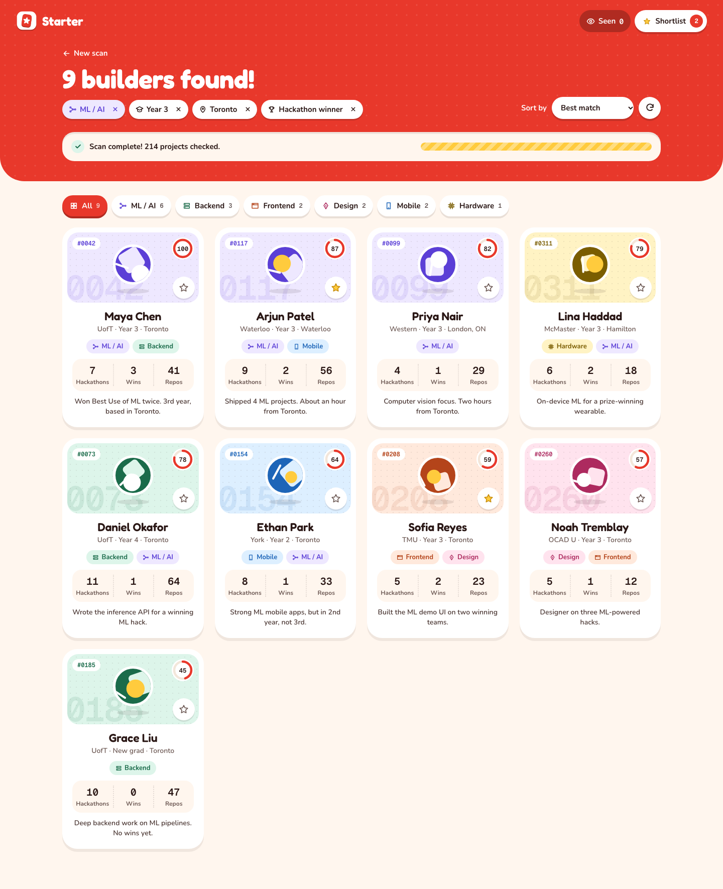
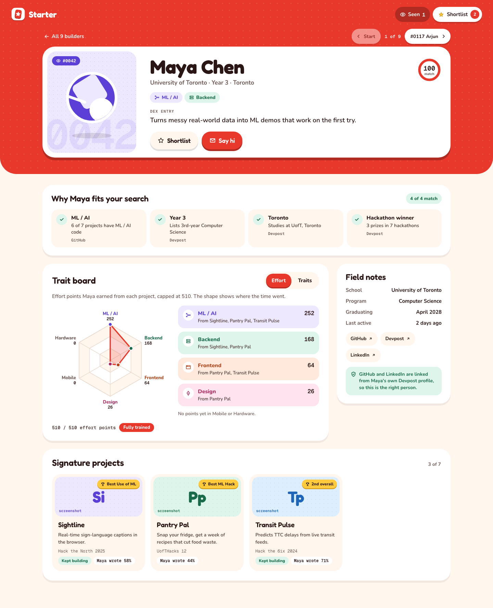

<h1 align="center">Starter</h1>

<p align="center">Find student developers to hire through the hackathon projects they've built.</p>

<p align="center">Built at Hack the Valley 11 · <a href="https://devpost.com/software/starter-c2m0vq">Devpost</a></p>

<p align="center">
  
</p>

## How it works

- Describe who you're hiring, like "ML intern, Toronto", or paste a job posting.
- Starter ranks students from Ontario hackathons against your search.
- Open someone to see why they matched, what kind of code they wrote and their strongest projects.
- Every fact shows where it came from. If we couldn't find something, it says "Not listed".
- "Say hi" drafts an email about one of their projects for you to finish.

<p align="center">
  
</p>

The people in these screenshots are made up.

## How we know who wrote what (technical)

Devpost lists who was on a team but not what each person did. A Python pipeline clones each project's repo and uses `git log --numstat` to count the lines every teammate added during the hackathon. Lockfiles, build output, vendored code and generated files don't count. Commits are matched to teammates through the GitHub account on their own Devpost profile, or by name within that team. Anyone we can't match stays unknown.

Rules based on the path, file type and imports sort each file into ML/AI, backend, frontend, design, mobile or hardware. Gemini only gets the files the rules can't place, with names and emails stripped out. School and graduation year come from People Data Labs, using the LinkedIn link on that Devpost profile, or from the profile's tagline.

The match score is plain math (`lib/scoring.ts`). For searches like "built a RAG pipeline", we embed project write-ups ahead of time with a local model (Snowflake arctic-embed) and compare them in Postgres with pgvector. Without a database it reads the same vectors from a JSON file.

## Run it

You need Node 20.9 or newer.

```bash
npm install
npm run dev
```

Open http://localhost:3000. This uses nine made-up sample students and needs no API keys.

Real student data isn't in the repo. To build your own you also need git, Python 3.11 and [uv](https://docs.astral.sh/uv/), on macOS or Linux. Copy `keys.env.example` to `keys.env`, fill it in, then run:

```bash
cd pipeline
uv venv --python 3.11
uv pip install --python .venv/bin/python -r requirements.txt
.venv/bin/python -m talentdex.run
cd ..
node scripts/embed.mjs
npm run dev:real
```

## Tests

```bash
npx playwright install chromium
npx playwright test
(cd pipeline && .venv/bin/python -m pytest tests)
```

The pytest line needs the Python setup above. Some browser tests only run with real data and are skipped otherwise.

## Built with

Next.js, React, TypeScript, Python, Gemini, People Data Labs, transformers.js and Postgres with pgvector.
